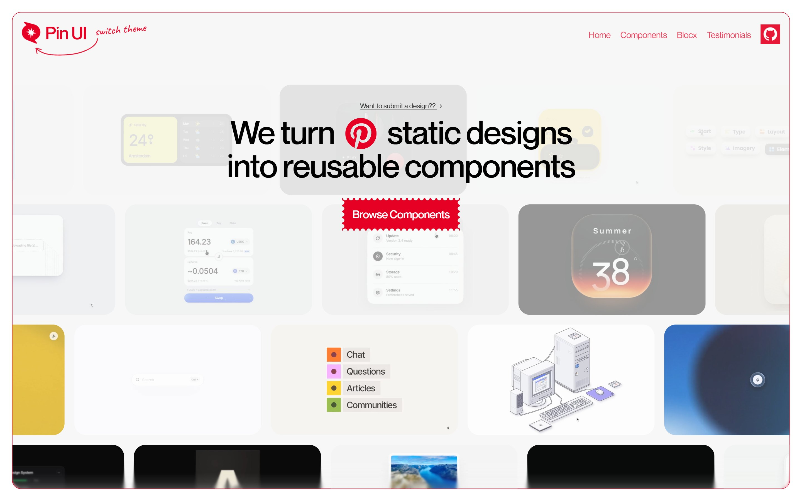

<p align="center">
  <a href="https://pinui.xyz">
    
  </a>
</p>

<h1 align="center">Pin UI</h1>

<p align="center">
  Static designs from Pinterest, turned into animated React components you can copy straight into your project.
</p>

<p align="center">
  <a href="https://pinui.xyz"><b>pinui.xyz</b></a>
  &nbsp;·&nbsp;
  <a href="https://pinui.xyz/components">Components</a>
  &nbsp;·&nbsp;
  <a href="https://pinui.xyz/blocx">Blocx</a>
</p>

<br>

<p align="center">
  <a href="https://pinui.xyz">
    <picture>
      <source media="(prefers-color-scheme: dark)" srcset=".github/hero-dark.jpg">
      
    </picture>
  </a>
</p>

## What it is

Pin UI is a free, open-source library of UI components, each one rebuilt from a design pinned on Pinterest. A design starts as a still image; it ends as a real, working component — animated, accessible, in both a light and a dark theme — that you can preview live, read the source of, and drop into your own app.

Alongside the components sits **Blocx**: whole page sections — heroes, pricing tables, sign-in pages, footers — that you can preview at desktop, tablet and phone sizes before you take them.

Everything is plain React and CSS, with [Motion](https://motion.dev) for the animation. There is no package to install and no theme to set up: a component is a file and its stylesheet, and once it is in your project it is yours.

## Use a component

Every component and block has its own install command on its page, ready to copy:

```bash
npx shadcn@latest add "https://pinui.xyz/r/<name>.json"
```

The shadcn CLI copies the files into your project and installs anything they need.

## Run it locally

```bash
npm install
npm run dev
```

Opens on [localhost:3100](http://localhost:3100). Needs Node 20.9 or newer.

## Creator

Designed and built by **Rachit Thakur**.

- **Website** — [pinui.xyz](https://pinui.xyz)
- **X** — [@RachitThakur146](https://x.com/RachitThakur146)
- **GitHub** — [@Rachit315](https://github.com/Rachit315)
- **Pinterest** — [the Pin UI board](https://in.pinterest.com/rachitrampage23/pin-ui/), where every component starts
- **Email** — [pinui.official@gmail.com](mailto:pinui.official@gmail.com)

Have a design you would like to see built? Send it through [the request form](https://tally.so/r/2EQY9e) or tag [@RachitThakur146](https://x.com/RachitThakur146) on X.

## License

The components are MIT licensed. The Pin UI name, logo and demo media are not included — see the [terms](https://pinui.xyz/terms).
