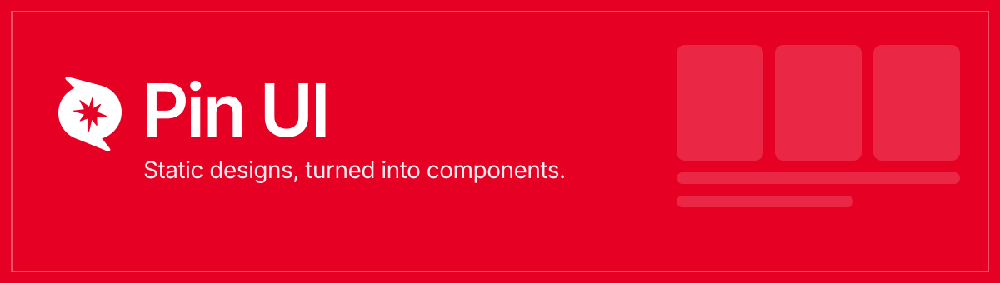

<p align="center">
  
</p>

<p align="center">
  <a href="https://pinui.xyz"><b>pinui.xyz</b></a>
  &nbsp;·&nbsp;
  <a href="https://x.com/RachitThakur146">@RachitThakur146</a>
</p>

# Pin UI

Designs from Pinterest, rebuilt as animated React components — plus **Blocx**,
whole page sections ready to drop in. Browse and preview everything at
[pinui.xyz](https://pinui.xyz).

## Use a component

```bash
npx shadcn@latest add "https://pinui.xyz/r/<slug>.json"
```

Every component's page has its exact command, ready to copy. The only dependency
is [Motion](https://motion.dev) — except Copy Paste Pad, a live 3-D render that
uses [three.js](https://threejs.org) instead; the CLI installs whichever one a
component needs.

## Run locally

```bash
npm install
npm run dev
```

Opens on http://localhost:3100. Requires Node 20.9+.

## License

MIT for the components. The Pin UI name, logo and demo media are not included —
see the [terms](https://pinui.xyz/terms).
